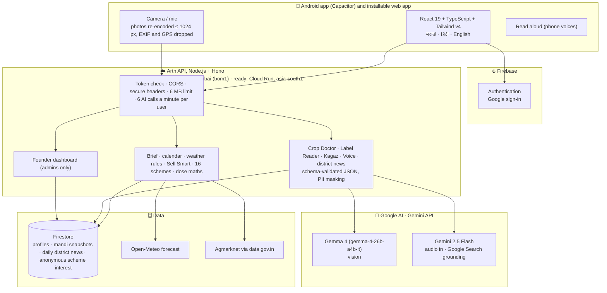

<div align="center">


# Arth · अर्थ

### *"What should I do on my farm today?"*

**Answered every morning for smallholder farmers in Maharashtra, in मराठी, हिंदी and English.**

<sub>आज शेतात काय करू? · आज खेत में क्या करूँ?</sub>

<br>

[](LICENSE)
[](frontend/)
[](frontend/)
[](backend/)
[](https://ai.google.dev/gemma)
[](firestore.rules)
[](backend/vercel.json)
[](docs/ANDROID.md)
[](backend/test/)

</div>

---

## 🌾 Why Arth exists

A small farmer in Nashik or Latur makes dozens of decisions a week with very little help:
*Is it safe to spray tomorrow? How much of this pesticide goes in my 16-litre tank? Should I sell
my onions at Lasalgaon today or wait? Which government scheme am I eligible for? What does this
bank letter mean?*

The answers exist, in weather models, APMC price boards, scheme rules and the small print on a
pesticide label, but they are scattered, mostly in English, and never about *his* farm.

**Arth brings them together into two or three jobs for today**, on a cheap Android phone, in the
farmer's own language, read aloud if he prefers to listen. There is no demo mode and no sample
data: after Google sign-in, everything on screen comes from live sources.

<table>
<tr>
<td align="center" width="25%"><h3>🌦️</h3><b>Live weather</b><br><sub>Open-Meteo 7-day forecast, spray, wind and heat rules</sub></td>
<td align="center" width="25%"><h3>💰</h3><b>Live mandi prices</b><br><sub>Agmarknet via data.gov.in, net earning after transport</sub></td>
<td align="center" width="25%"><h3>🌱</h3><b>48 crops</b><br><sub>10 with full support, 38 more with prices and schemes</sub></td>
<td align="center" width="25%"><h3>🗣️</h3><b>3 languages, voice</b><br><sub>Marathi, Hindi, English; ask and listen</sub></td>
</tr>
</table>

---

## 📱 What a farmer sees

| Screen | What it does | Where the answer comes from |
| :--- | :--- | :--- |
| 🔐 **Sign in** | Dawn over the hills, the wordmark, a tagline in three languages, then **Sign in with Google**, the only way in. | Firebase Auth |
| ✅ **Consent** | What Arth keeps, what it never keeps (photos, voice, Aadhaar or bank numbers), and that the Arth team can see the profile only to help the farmer. | — |
| 📝 **Onboarding** | Six questions: language, name, place, crops, land, water. Soil is never asked; it comes from the district. Crops: 10 main tiles plus **Other crops** (38 more, searchable in any language) and crops the farmer types in. Ends with a welcome screen. | Location → district |
| 🏠 **Home: Aaj Ka Kaam** | The sky now, how far into the season we are, the **single most important job today** in big type, where each crop usually stands this week, 4-day weather, price moves and **farm news for the district from official sources only**. One button reads it all aloud. | Open-Meteo · Agmarknet · crop calendar · Gemini + Google Search |
| 🌦️ **Weather** | Now, 7 days and advisories such as *"Don't spray tomorrow: 80 % rain"*. | Open-Meteo + fixed thresholds |
| 📈 **Mandi & Sell Smart** | Nearby APMC prices, a 30-day trend, and *sell now or wait* after the cost of trucking to each market. | Agmarknet + code |
| 🩺 **Crop Doctor** | Photo of a sick leaf → the problem, severity, organic and chemical remedies, prevention. Unsure → *"not sure"* and the Kisan Call Centre. | Gemma 4 vision picks; checked advice from our data |
| 🏷️ **Label Reader** | Photo of a pesticide label → the dose for *this farmer's* sprayer tank, waiting period, safety. **Never guesses a dose.** | Gemma 4 reads · code calculates |
| 📄 **Kagaz Samjho** | Photo of a government or bank paper → plain-language summary, deadlines, next steps, with Aadhaar, PAN, bank and phone numbers masked. | Gemma 4 + PII masking |
| 📅 **Crop calendar** | A year map of the farm, what is in the field now, which crops can be sown **today** (days left) and which windows open soon, each with a *why now*. | Crop calendars + live weather and prices |
| 🏛️ **Schemes** | One question per screen → which of 16 central and Maharashtra schemes he qualifies for, why, and which documents to carry. | Rules engine (no AI) |
| 🎙️ **Voice** | Ask anything by voice from any screen; Arth answers aloud and can open the right screen. | Gemini 2.5 Flash (audio in) |
| 👤 **Profile & Settings** | Farm, district soil, language, sprayer tank, alerts, privacy, delete account, and **How to use Arth**: a 7-step guide, one screen at a time. | Profile |
| 📊 **Founder dashboard** | Admins only: sign-ups, who opened the app today and this week, farmers by district, crop and language, and who has gone quiet. | Firestore (no UID, email or location shown) |

---

## 🛡️ The safety rule

> [!IMPORTANT]
> **The model reads and picks. Plain, tested code decides.**

| 🧠 The model does | 🧮 Arth's code does |
| :--- | :--- |
| Picks which **known** crop problem a leaf photo shows | The advice the farmer reads (checked text in 3 languages) |
| Copies the dose printed on a label | Scales that dose to the farmer's tank |
| Explains a document in the farmer's language | Masks Aadhaar, PAN, IFSC, bank, phone and email in the answer |
| Understands a spoken question | Sell now or wait · scheme eligibility · sowing windows · spray, wind and heat advisories |

Low confidence, a close second guess, an unclear photo or an unreadable label → no guess, only the
**Kisan Call Centre · 📞 [1800-180-1551](tel:18001801551)**. The same photo always gets the same answer.

---

## ✨ Features in depth

<details open>
<summary><b>🏠 Aaj Ka Kaam: today's jobs, ranked</b></summary>
<br>

[`services/brief.ts`](backend/src/services/brief.ts) combines the live forecast, live prices for the
farmer's own crops and the crop calendar into **at most three actions, by priority** (spray,
irrigate, harvest, sell, sow, protect), each with a button to the right screen. No AI, so it is fast.
Weather rules in [`services/weather.ts`](backend/src/services/weather.ts) are plain thresholds:

| Rule | Trigger |
| :--- | :--- |
| 🌧️ Don't spray | rain chance **≥ 60 %** or **≥ 5 mm** (danger at ≥ 80 % within a day) |
| 💨 Don't spray | wind **≥ 20 km/h** (danger at ≥ 30) |
| 🔥 Irrigate / protect | max temperature **≥ 38 °C** (danger at ≥ 42) |
| ⛈️ Heavy rain | **≥ 35 mm** in a day |

</details>

<details>
<summary><b>📈 Sell Smart: sell now or wait?</b></summary>
<br>

[`services/mandi.ts`](backend/src/services/mandi.ts) reads today's Maharashtra APMC prices and the
price history from **Agmarknet on data.gov.in** ([`services/sell.ts`](backend/src/services/sell.ts) decides).

- Markets within **300 km**; straight-line distance × **1.25** for road distance.
- Transport estimated at **₹2 per quintal per km** (configurable, always shown as an estimate).
- Trend slope by least squares over the last 7 days.
- **WAIT** only when prices are clearly rising (**> 0.5 % a day**) *and* the crop keeps (dry grain,
  cured onion, cotton lint); perishables like tomato and grapes are always **SELL NOW**.
- Prices are cached for 3 hours and the last good prices are kept in Firestore, so a data.gov.in
  outage still shows prices.

</details>

<details>
<summary><b>🩺 Crop Doctor: the model picks, it never writes the advice</b></summary>
<br>

[`services/doctor.ts`](backend/src/services/doctor.ts) gives Gemma 4 a list of **38 checked
conditions** (diseases, pests, deficiencies and "healthy") for the 10 main crops, from
[`data/conditions.ts`](backend/src/data/conditions.ts). The model describes what it sees, picks one,
and gives a confidence and a runner-up. The farmer reads the checked advice for that condition, in
Marathi, Hindi or English. Below 60 % confidence, or when the second choice is close, the app sends
the farmer to an expert. Identical photos are answered from a cache (only a hash is kept, never the photo).

</details>

<details>
<summary><b>🏷️ Label Reader: the dose, never a guess</b></summary>
<br>

Gemma 4 reads the label (product, active ingredient, formulation, printed dose, waiting period).
`scaleDose` in [`services/ai.ts`](backend/src/services/ai.ts) scales the printed rate to the farmer's
tank. If the label gives no clear per-litre dose, the answer is **no dose** plus the Kisan Call
Centre, never an estimate.

</details>

<details>
<summary><b>🌱 48 crops, honestly tiered</b></summary>
<br>

| Tier | Crops | What works |
| :--- | :--- | :--- |
| **Core (10)** | onion, soybean, tomato, grapes, cotton, wheat, gram, sugarcane, pomegranate, maize | everything: calendar, weather jobs, crop doctor, prices, schemes |
| **Other crops (38)** | tur, jowar, bajra, paddy, ragi, moong, urad, groundnut, banana, orange, mosambi, chilli, turmeric and more | mandi prices, sell advice, price alerts, schemes; crop doctor checks against all known problems |
| **Typed in** | anything else the farmer grows | kept on the profile and shown by name; no prices |

The catalog lives in [`data/crops.ts`](backend/src/data/crops.ts) (Agmarknet 2.0 names, checked
against the live feed) and [`frontend/src/lib/crops.ts`](frontend/src/lib/crops.ts); a test keeps them in step.

</details>

<details>
<summary><b>🏛️ Schemes: eligibility by rules, not by a chatbot</b></summary>
<br>

[`services/schemes.ts`](backend/src/services/schemes.ts) checks the farmer's answers against:
PM-KISAN · Namo Shetkari Mahasanman Nidhi · PM Fasal Bima Yojana · Kisan Credit Card ·
Soil Health Card · PMKSY Per Drop More Crop · MahaDBT farm mechanisation · Dr. Babasaheb Ambedkar
Krishi Swavalamban · Birsa Munda Krishi Kranti · Magel Tyala Saur Krushi Pump · Magel Tyala Shettale ·
Bhausaheb Fundkar Phalbag Lagvad · MIDH horticulture · PM Kisan Maandhan · Gopinath Munde Shetkari
Apghat Suraksha Sanugrah Anudan · weather-based fruit crop insurance (16 in all).
Every result says **why**, the benefit, the documents to carry and the official link. Rules are
simplified; the app asks the farmer to confirm on the official site.

</details>

<details>
<summary><b>📰 District news: official sources or nothing</b></summary>
<br>

[`services/news.ts`](backend/src/services/news.ts) asks **Gemini 2.5 Flash with Google Search grounding**
once per district per day for that day's farm news (IMD warnings and agromet advisories, scheme
deadlines, APMC notices, Krishi Vibhag and ICAR advisories), in English, Hindi and Marathi at once.
An item is kept only when its link is a page the search actually returned, on an official host
(`*.gov.in`, `*.nic.in`, ICAR, Maharashtra's agricultural universities). The day's answer, even
empty, is cached in Firestore, so 36 districts cost at most 36 grounded calls a day. The model sees
only the district and the date.

</details>

<details>
<summary><b>📊 Founder dashboard</b></summary>
<br>

[`routes/admin.ts`](backend/src/routes/admin.ts): admins are verified Google sign-in emails listed
in `ARTH_ADMIN_EMAILS`. The dashboard shows totals, sign-ups, active and quiet farmers, and counts by
district, crop and language. It never returns a user ID, email or coordinates, and is not cached.

</details>

<details>
<summary><b>🎙️ Voice-first, in three languages</b></summary>
<br>

- **Listening:** up to 15 seconds of audio go to **Gemini 2.5 Flash**, which takes audio directly.
  It returns what the farmer said, a short answer, and which screen to open or form field to fill.
- **Speaking:** answers are read aloud with the phone's own voices (`mr-IN`, `hi-IN`, `en-IN`).
  Many phones have no Marathi voice, so Marathi falls back to a Hindi voice (same Devanagari
  script), and the app explains what to install when no voice exists.

</details>

---

## 🏗️ Architecture



The same React build runs as a PWA and, through Capacitor, as the Android app
([docs/ANDROID.md](docs/ANDROID.md)).

**Where it runs today:** the API is on **Vercel in Mumbai** ([`backend/vercel.json`](backend/vercel.json),
entry [`backend/api/index.ts`](backend/api/index.ts)), with Firestore and Firebase Auth on Google
Cloud; keys live in Vercel's environment variables. Sign-in tokens are checked with `jose` against
Google's public keys. The Android app calls this API directly.

**Google Cloud Run, on Buildathon credits:** [`scripts/deploy.ps1`](scripts/deploy.ps1) deploys
everything with one command: it stores the keys in Secret Manager, builds and deploys the API to
Cloud Run in `asia-south1` (scales from zero, up to 3 instances), and publishes the web app on
Firebase Hosting with `/api` routed to Cloud Run, plus the Firestore rules.

---

## 📊 Real data, no sample data

| What | Source | Freshness |
| :--- | :--- | :--- |
| Weather, 7-day forecast | [Open-Meteo](https://open-meteo.com) | live, cached 30 min |
| Mandi prices, 30-day trend | DMI Agmarknet via [data.gov.in](https://data.gov.in) | live, cached 3 h, last good copy in Firestore |
| District soil type | Maharashtra state soil map (black, red, laterite, alluvial) | per district, farmer can correct it |
| Crop stages and sowing windows | Maharashtra crop calendars for the 10 core crops | reviewed by hand |
| Crop problems and remedies | 38 checked conditions in English, Hindi and Marathi | reviewed by hand |
| District farm news | Gemini 2.5 Flash with Google Search grounding, official hosts only | once a day per district, cached in Firestore |
| Government schemes | 16 central and Maharashtra schemes, simplified rules | reviewed by hand; the farmer confirms on the official site |
| Photo, label, document, voice | Gemma 4 and Gemini 2.5 Flash via the Gemini API | per request, never stored |

---

## 🔒 Privacy and security

| # | Promise | How |
| :---: | :--- | :--- |
| 1 | **Google sign-in only** | The backend verifies the Firebase ID token; the user ID comes only from it. |
| 2 | **Photos and voice are never stored** | Handled in memory and discarded; the crop doctor cache keeps only a hash. |
| 3 | **Personal numbers are masked** | Aadhaar, PAN, IFSC, bank account, phone and email are masked in every AI answer before it is shown. |
| 4 | **The model never gets the profile** | Only the media, the crop, district, season and numbers; never name, email, phone, user ID or address. |
| 5 | **Location is rounded to ~1 km** | Two decimals, on the phone and on the server. |
| 6 | **Delete means delete** | Deleting the account removes the profile from Firestore. |
| 7 | **Anonymous, opt-in insights only** | A farmer can share interest in a scheme: scheme, district, crop, land band, language and day. No name or ID. |
| 8 | **Said plainly at consent** | The consent screen says the Arth team can see the profile, only to help the farmer. The founder dashboard never shows a user ID, email or location. |
| 9 | **Locked-down web layer** | Strict CSP, `X-Frame-Options: DENY`, 6 MB upload limit, 6 AI calls a minute per user, keys only in the host's secret store (Vercel environment variables today, Secret Manager on Cloud Run). |

---

## 💻 Run it locally

| Tool | Notes |
| :--- | :--- |
| **Node.js 20+** and npm | backend and frontend |
| **Firebase project** | Google sign-in enabled ([console](https://console.firebase.google.com)) |
| **Gemini API key** | free from [Google AI Studio](https://aistudio.google.com) |
| **data.gov.in API key** | free, from *My Account* on [data.gov.in](https://data.gov.in) |

**Backend** (port 8000):

```bash
cd backend
npm install
cp .env.example .env     # ARTH_FIREBASE_PROJECT_ID, GEMINI_API_KEY, ARTH_DATA_GOV_IN_API_KEY
npm run dev
```

**Frontend** (port 5173; `/api` is proxied to the backend):

```bash
cd frontend
npm install
cp .env.example .env.local   # the four VITE_FIREBASE_* values
npm run dev
```

Open <http://localhost:5173>, choose a language and **Sign in with Google**.

Optional backend settings: `ARTH_ADMIN_EMAILS` (comma-separated Google emails that may open the
founder dashboard) and `ARTH_NEWS_MODEL` (default `gemini-2.5-flash`).

**Android:** see [docs/ANDROID.md](docs/ANDROID.md) (Capacitor, Firebase setup, building and installing the APK).

**Vercel (today):** import the repo with `backend` as the project root; set the variables from
`backend/.env.example` (with `ARTH_STORE=firestore` and `ARTH_FIREBASE_SERVICE_ACCOUNT`) in the
Vercel dashboard. Every push to `main` deploys.

**Google Cloud:** `powershell -ExecutionPolicy Bypass -File scripts/deploy.ps1` (needs the gcloud
and firebase CLIs and billing or credits on the project).

---

## 🔌 API

Full contract: [`docs/SPEC.md`](docs/SPEC.md). Every request carries the Firebase ID token. JSON is
camelCase, money is whole ₹, prices are ₹/quintal. Errors look like `{ "error": { "code", "message" } }`.

| Method | Path | Returns |
| :--- | :--- | :--- |
| `GET` `PUT` `DELETE` | `/farmer/me` | The profile; delete removes it. |
| `GET` | `/brief?lang=` | Weather now and 4 days, 2–3 actions, price alerts, crops in the field, season progress. |
| `GET` | `/weather?lat=&lon=&lang=` | Now, 7 days, spray, wind and heat advisories. |
| `GET` | `/calendar?lang=` | Year map, crops in the field, sow-now and upcoming crops with *why now*. |
| `GET` | `/soil?lang=` | District soil type with plain-language tips. |
| `GET` | `/mandi/prices` | Nearby markets and the 30-day trend. |
| `POST` | `/mandi/sell-advice` | Sell now or wait, after transport, with every option. |
| `POST` | `/ai/crop-doctor` · `/ai/label-reader` · `/ai/explain-document` · `/ai/voice` | AI results (multipart). |
| `POST` | `/schemes/match` · `/schemes/share` | Eligible schemes with reasons; opt-in anonymous interest. |
| `GET` | `/news?lang=` | Today's official farm news for the farmer's district (0–4 items). |
| `GET` | `/admin/access` · `/admin/overview` | Whether the caller is an admin; the founder dashboard (admins only). |
| `GET` | `/health` | Open, no sign-in: model status; `?upstreams` checks weather and mandi sources. |

---

## 🗂️ Repository layout

```
Arth/
├── frontend/                  React 19 PWA + Android app (Capacitor)
│   ├── android/               native Android project
│   └── src/
│       ├── app/               router, layout, bottom nav, mic
│       ├── features/          auth, onboarding, brief, weather, mandi, doctor, label,
│       │                      kagaz, calendar, schemes, profile, admin
│       ├── components/        shared UI, voice (listen and read aloud)
│       ├── lib/               API client, Firebase, crop catalog
│       └── i18n/              en / hi / mr
├── backend/                   Node.js + Hono API (Vercel today, Cloud Run ready)
│   ├── api/index.ts           Vercel entry
│   ├── src/
│   │   ├── routes/            farmer, weather + brief, plan (calendar, soil, schemes), mandi, ai, news, admin
│   │   ├── services/          brief, weather, mandi, sell, calendar, doctor, ai, pii, schemes, news, llm
│   │   ├── data/              crops, crop calendars, crop conditions, districts, soils, texts (en/hi/mr)
│   │   └── store/             Firestore (production) and memory (development)
│   └── test/                  112 tests, no network or model needed
├── scripts/deploy.ps1         one-command deploy to Google Cloud
├── firebase.json              Hosting, /api rewrite to Cloud Run, security headers
└── docs/                      API contract (SPEC.md), Android guide, field test, demo video
```

---

## 🧪 Testing

```bash
cd backend
npm run typecheck
npm test            # 112 tests: rules, dose, PII, crop doctor, crops, mandi, sell, calendar, schemes, news, admin, sign-in, API contract

cd ../frontend
npm run lint
npm run build       # strict type-check + production build
```

External services and the models are faked, so the backend suite runs offline in seconds.

---

## 📜 Models, tools and licenses

| Component | Role in Arth | License |
| :--- | :--- | :--- |
| **[Gemma 4](https://ai.google.dev/gemma)** via the Gemini API | Vision: leaf, label, document; schema-validated JSON | Gemma terms (open weights) |
| **[Gemini 2.5 Flash](https://ai.google.dev)** | Voice: audio in, answer and navigation out; district news with Google Search grounding | Google API terms |
| **Google AI Studio** | The Gemini API project and key | Google API terms |
| **Google Antigravity · Google Agent Skills** | Used to build Arth | Google terms |
| **Google Cloud**: Firestore today; Cloud Run, Cloud Build, Secret Manager on Buildathon credits | Data now; hosting the API next | Google Cloud terms |
| **Firebase**: Authentication (Hosting ready) | Google sign-in, web app | Google service terms |
| **Vercel** (Mumbai) | Hosting the API today | Vercel terms |
| **Web Speech API** | Reading answers aloud | Browser / OS built-in |
| **React 19 · Vite · Tailwind v4 · TanStack Query · i18next · Recharts · Capacitor** | Frontend and Android | MIT |
| **Hono · Zod · firebase-admin · @google/genai** | Backend | MIT / Apache 2.0 |
| **[Open-Meteo](https://open-meteo.com)** | Weather | CC BY 4.0 |
| **Agmarknet via [data.gov.in](https://data.gov.in)** | Mandi prices | Government Open Data License – India |
| **Arth's own code** | Everything in this repository | [Apache 2.0](LICENSE) |

---

## 👤 Founder

<table>
<tr>
<td align="center"><a href="https://www.linkedin.com/in/rushikesh-patil-a45469373/"><br><b>Rushikesh Patil</b></a><br><sub>Founder · B.Tech AI & Data Science</sub></td>
</tr>
</table>

Built by a farming family's son for farmers like his own. Thanks to **Aman Dadsena** and
**Mohanish Das**, who worked on the earlier team version of Arth.

## 🙏 Data sources and credits

- **Design system:** [Project Rutu](https://github.com/rushii23-dev/Project-Rutu) (tokens, type, cards, bottom nav).
- **Weather:** [Open-Meteo](https://open-meteo.com) (CC BY 4.0).
- **Mandi prices:** DMI Agmarknet via [data.gov.in](https://data.gov.in).
- **Fonts:** Inter, Anek Devanagari and Tiro Devanagari Hindi (SIL Open Font License, bundled in [`frontend/public/fonts`](frontend/public/fonts)).
- **Helpline:** Kisan Call Centre, 1800-180-1551.

---

<div align="center">

**Apache 2.0**: see [LICENSE](LICENSE)

<sub>Made for the farmers of Maharashtra · महाराष्ट्रातील शेतकऱ्यांसाठी 🌾</sub>

</div>
